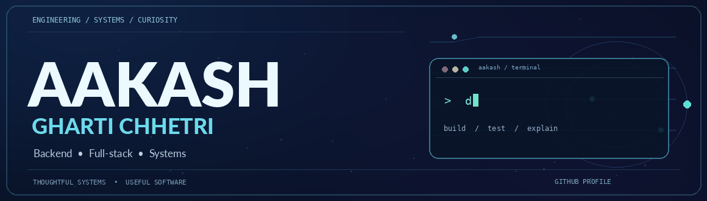
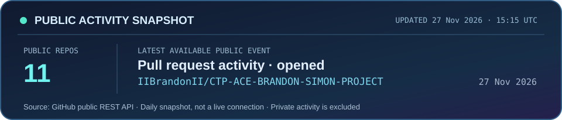

<!--
  Aakash Gharti Chhetri · GitHub profile
  Original motion artwork is stored in assets/. Animation is not a claim of AI autonomy.
  The reduced-motion image is a still version of the hero.
-->

  <picture>
    <source media="(prefers-reduced-motion: reduce)" srcset="./assets/hero-static.png" />
    
  </picture>

  <h1>Hi, I'm Aakash 👋</h1>
  
<strong>Software Developer · Backend & Full-Stack · Systems Thinking</strong>

  
  
  

  
New York City · Hunter College · Computer Science, with an Economics minor

---

### The short version

I build software to understand what happens **beyond the happy path**: when a workflow needs recovery, an API behaves unexpectedly, or a scheduling algorithm faces a difficult input.

I'm pursuing a **B.A. in Computer Science at Hunter College**, with an **Economics minor** (expected **December 2026**). My repositories include independent systems experiments, full-stack applications, coursework, and collaborative projects.

I care about four things: **clear design, correct behavior, useful tests, and honest explanations of tradeoffs**.

 

### Featured systems / real code

<table>
<tr>
<td width="50%" valign="top">
  <h3>01 · <a href="https://github.com/aakashghartichhetri/resurrection">Resurrection</a></h3>
  
<strong>Java · Spring Boot · PostgreSQL</strong>

  
A workflow recovery experiment exploring deterministic event replay, checkpoints, integrity verification, and explicit recovery approval.

  
<a href="https://github.com/aakashghartichhetri/resurrection">Source code</a> · <a href="https://github.com/aakashghartichhetri/resurrection/actions">Tests & CI</a>

</td>
<td width="50%" valign="top">
  <h3>02 · <a href="https://github.com/aakashghartichhetri/echo">ECHO</a></h3>
  
<strong>TypeScript · PostgreSQL</strong>

  
A black-box API testing platform that explores observed behavior and infers bounded finite-state models.

  
<a href="https://github.com/aakashghartichhetri/echo">Source code</a> · <a href="https://github.com/aakashghartichhetri/echo/actions">Tests & CI</a>

</td>
</tr>
<tr>
<td width="50%" valign="top">
  <h3>03 · <a href="https://github.com/aakashghartichhetri/event-horizon">Event Horizon</a></h3>
  
<strong>C++20 · Simulation</strong>

  
Models exchange matching, clearing, and how disruptions can propagate through a simulated financial system.

  
<a href="https://github.com/aakashghartichhetri/event-horizon">Source code</a> · <a href="https://github.com/aakashghartichhetri/event-horizon/blob/main/docs/ENGINEERING.md">Engineering notes</a>

</td>
<td width="50%" valign="top">
  <h3>04 · <a href="https://github.com/aakashghartichhetri/omega">OMEGA</a></h3>
  
<strong>Rust · Python · FastAPI · PostgreSQL</strong>

  
Compares scheduling strategies with independently checked assignments and reproducible experiments.

  
<a href="https://github.com/aakashghartichhetri/omega">Source code</a> · <a href="https://github.com/aakashghartichhetri/omega/actions">Tests & CI</a>

</td>
</tr>
</table>

**Built with teams:** [Translify](https://github.com/aakashghartichhetri/Translify), a Flutter/FastAPI multimodal translation capstone ([my pull requests](https://github.com/aakashghartichhetri/Translify/pulls?q=is%3Apr+author%3Aaakashghartichhetri)); and [Accessibility Copilot](https://github.com/aakashghartichhetri/Accessibility-Copilot-Team11-CTP-Hackathon), a team hackathon prototype for AI-assisted accessibility analysis.

These are research-style simulations, prototypes, and engineering projects. They are not claims of production-scale adoption, audited security, or independently certified performance. Shared projects include other contributors' work.

### How I think about engineering

  

**Design for failure.** Think about retries and recovery. **Verify the behavior.** Prefer meaningful tests over impressive test counts. **Measure before optimizing.** Make claims reproducible. **Write it down.** Make the tradeoffs understandable to another developer.

### Languages & tools

  
<strong>Languages</strong>

  &nbsp;
  &nbsp;
  &nbsp;
  &nbsp;
  &nbsp;
  &nbsp;
  

  
<strong>Build · data · delivery</strong>

  &nbsp;
  &nbsp;
  &nbsp;
  &nbsp;
  &nbsp;
  &nbsp;
  &nbsp;
  

### Public signal / automatically refreshed

  
    
  
  
Generated from GitHub's public API by a scheduled workflow. Updates are periodic, not live telemetry.

  
<strong>🎮 Open the animated contribution arcade</strong>

   
  <picture>
    <source media="(prefers-color-scheme: dark)" srcset="https://raw.githubusercontent.com/aakashghartichhetri/aakashghartichhetri/output/pacman-contribution-graph-dark.svg" />
    
  </picture>
  
The game appears after the automated workflow successfully publishes the output branch.

  
<strong>📊 More public GitHub statistics</strong>

   
  

    
    
  

---

  <h3>Have an interesting engineering problem?</h3>
  
I'm happy to talk about backend systems, thoughtful products, technical experiments, and collaborative projects.

  
  
  
Build thoughtfully · Test what matters · Make the reasoning visible

