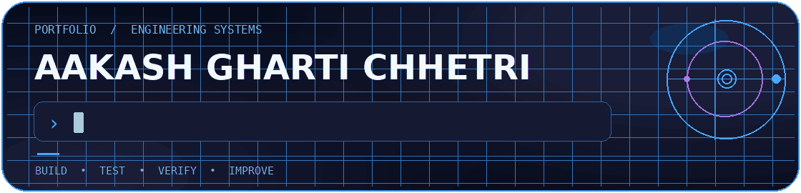
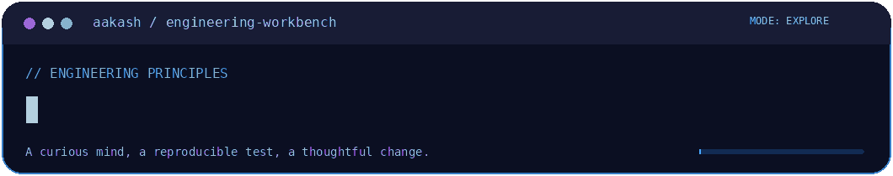

<picture>
  <source media="(prefers-reduced-motion: reduce)" srcset="./assets/hero-static.svg" />
  
</picture>

  
  
  

**Thoughtful systems. Useful software. Continuous improvement.**

---

### 👋 Hey, I'm Aakash

I'm a **computer science student and software developer in New York City**, pursuing a **B.A. in Computer Science at Hunter College**, with an **Economics minor** (expected **December 2026**).

I enjoy building backend services, full-stack applications and experiments where the interesting questions are about **correctness, performance, system behavior and what happens when things fail**. My repositories include independent projects, research-style simulations, coursework and collaborative work.

  

### ⚙️ Technology I work with

**Languages**

&nbsp;&nbsp;
&nbsp;&nbsp;
&nbsp;&nbsp;
&nbsp;&nbsp;
&nbsp;&nbsp;
&nbsp;&nbsp;

**Frameworks · data · tooling**

&nbsp;&nbsp;
&nbsp;&nbsp;
&nbsp;&nbsp;
&nbsp;&nbsp;
&nbsp;&nbsp;
&nbsp;&nbsp;
&nbsp;&nbsp;

### 🧩 Engineering projects I can show

| Project | The engineering question | Explore |
|:--|:--|:--|
| **[Resurrection](https://github.com/aakashghartichhetri/resurrection)** | How can a workflow recover its state safely using events, checkpoints and explicit approval? | [Code](https://github.com/aakashghartichhetri/resurrection) · [CI](https://github.com/aakashghartichhetri/resurrection/actions) |
| **[ECHO](https://github.com/aakashghartichhetri/echo)** | How can we explore API behavior and infer bounded state-machine models from observations? | [Code](https://github.com/aakashghartichhetri/echo) · [CI](https://github.com/aakashghartichhetri/echo/actions) |
| **[Event Horizon](https://github.com/aakashghartichhetri/event-horizon)** | What happens when payment failures spread through a simulated exchange and clearing system? | [Code](https://github.com/aakashghartichhetri/event-horizon) · [Engineering notes](https://github.com/aakashghartichhetri/event-horizon/blob/main/docs/ENGINEERING.md) |
| **[OMEGA](https://github.com/aakashghartichhetri/omega)** | How do scheduling strategies compare when their assignments are checked and experiments are repeatable? | [Code](https://github.com/aakashghartichhetri/omega) · [CI](https://github.com/aakashghartichhetri/omega/actions) |

**Collaborative projects**

- **[Translify](https://github.com/aakashghartichhetri/Translify)** — Flutter + FastAPI capstone exploring text, image and speech translation. Includes collaborative backend and mobile engineering work; see the [PR history](https://github.com/aakashghartichhetri/Translify/pulls?q=is%3Apr+author%3Aaakashghartichhetri) for individual contributions.
- **[Accessibility Copilot](https://github.com/aakashghartichhetri/Accessibility-Copilot-Team11-CTP-Hackathon)** — Team hackathon prototype exploring AI-assisted accessibility analysis and browser-based checks. Automated scans do not establish full WCAG conformance.

> These are engineering projects, simulations and prototypes—not claims of production-scale operation, independent security certification or commercial adoption.

### 📡 Public engineering signal · auto-refreshed

  
    
  
   
  The card is regenerated daily from GitHub's **public** API. Its timestamp shows when it was last updated; it is not real-time monitoring.

### 📊 GitHub at a glance

  
  
   
  

### 🕹️ Contributions in motion

<strong>PAC-MAN</strong>

<picture>
  <source media="(prefers-color-scheme: dark)" srcset="https://raw.githubusercontent.com/aakashghartichhetri/aakashghartichhetri/output/pacman-contribution-graph-dark.svg" />
  <source media="(prefers-color-scheme: light)" srcset="https://raw.githubusercontent.com/aakashghartichhetri/aakashghartichhetri/output/pacman-contribution-graph.svg" />
  
</picture>

  
<strong>🎮 Bonus mode — GALAGA</strong>

   
  <picture>
    <source media="(prefers-color-scheme: dark)" srcset="https://raw.githubusercontent.com/aakashghartichhetri/aakashghartichhetri/output/galaga-contribution-graph-dark.svg" />
    <source media="(prefers-color-scheme: light)" srcset="https://raw.githubusercontent.com/aakashghartichhetri/aakashghartichhetri/output/galaga-contribution-graph.svg" />
    
  </picture>

Arcade assets are generated by a scheduled [GitHub Action](https://github.com/aakashghartichhetri/aakashghartichhetri/actions/workflows/profile-dynamics.yml) using [Pac-Man Contribution Graph](https://github.com/abozanona/pacman-contribution-graph). They appear after the first successful workflow run. SVG motion support can vary by GitHub's rendering context; the local GIF animations above are the reliable moving text elements.

### 🤝 Let's build something thoughtful

I enjoy conversations about software engineering, backend design, reliable systems, technical projects and learning by building.

  
  
  

Design for clarity · Build with curiosity · Verify what matters

